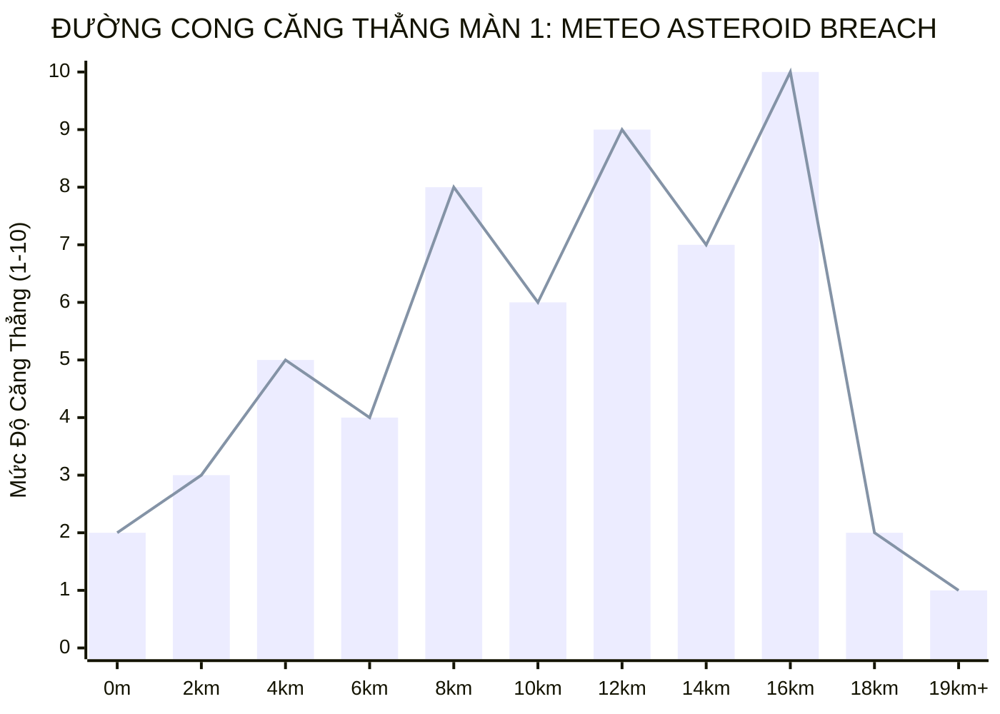
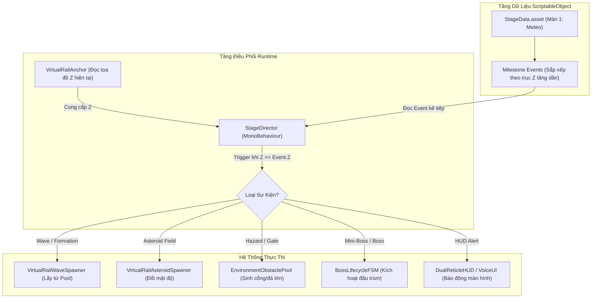
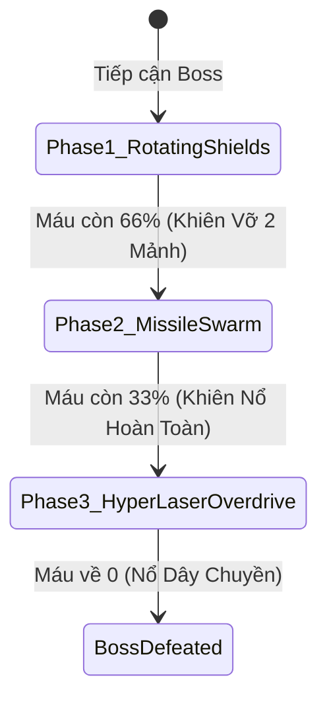

# TÀI LIỆU THIẾT KẾ MÀN CHƠI TOÀN DIỆN (LEVEL DESIGN SPECIFICATION - LDS v1.0.0)
> **Dự án:** 3D Space Shooter (Virtual Rail Arcade Shooter)  
> **Chuẩn tham chiếu:** Star Fox 64 (N64 US Rev 1.1), Panzer Dragoon Orta, Sin & Punishment  
> **Trạng thái:** Tài liệu Đặc tả Thiết kế (Design Specification - Không can thiệp mã nguồn)  
> **Hiệu lực:** Nguồn Chân Lý Thiết Kế Màn Chơi (Level Design Source of Truth)

---

## MỤC LỤC
1. [Triết Lý Thiết Kế & Trụ Cột Trải Nghiệm (Design Pillars)](#1-triết-lý-thiết-kế--trụ-cột-trải-nghiệm)
2. [Đặc Tính Động Lực Học Đường Ray & Thông Số Không Gian](#2-đặc-tính-động-lực-học-đường-ray--thông-số-không-gian)
3. [Đường Cong Nhịp Độ & Căng Thẳng (Pacing & Tension Curve)](#3-đường-cong-nhịp-độ--căng-thẳng-pacing--tension-curve)
4. [Kiến Trúc Hệ Thống Màn Chơi Hướng Dữ Liệu (Data-Driven Architecture)](#4-kiến-trúc-hệ-thống-màn-chơi-hướng-dữ-liệu-data-driven-architecture)
5. [Thiết Kế Chi Tiết Màn Chơi Mẫu 1: Vành Đai Thiên Thạch Meteo](#5-thiết-kế-chi-tiết-màn-chơi-mẫu-1-vành-đai-thiên-thạch-meteo)
   - [Giai đoạn 1: Khởi Động & Nhận Diện ($Z: 0\text{m} - 2,500\text{m}$)](#giai-đoạn-1-khởi-động--nhận-diện-z-0m---2500m)
   - [Giai đoạn 2: Chiến Thuật Phi Đội & Đột Kích Sau Lưng ($Z: 2,500\text{m} - 6,500\text{m}$)](#giai-đoạn-2-chiến-thuật-phi-đội--đột-kích-sau-lưng-z-2500m---6500m)
   - [Giai đoạn 3: Hẻm Tử Thần & Vòng Năng Lượng ($Z: 6,500\text{m} - 11,500\text{m}$)](#giai-đoạn-3-hẻm-tử-thần--vòng-năng-lượng-z-6500m---11500m)
   - [Giai đoạn 4: Trung Hạm Tuần Dương Mini-Boss ($Z: 11,500\text{m} - 14,500\text{m}$)](#giai-đoạn-4-trung-hạm-tuần-dương-mini-boss-z-11500m---14500m)
   - [Giai đoạn 5: Đại Chiến Pháo Đài Lõi Boss Cuối ($Z: 14,500\text{m} - 19,000\text{m}$)](#giai-đoạn-5-đại-chiến-pháo-đài-lõi-boss-cuối-z-14500m---19000m)
   - [Giai đoạn 6: Thoát Ly & Bảng Vinh Danh ($Z > 19,000\text{m}$)](#giai-đoạn-6-thoát-ly--bảng-vinh-danh-z--19000m)
6. [Hệ Thống Phân Loại Địch & Ma Trận Cân Bằng (Archetypes & Balance Sheet)](#6-hệ-thống-phân-loại-địch--ma-trận-cân-bằng)
7. [Cơ Chế Thưởng Rủi Ro & Săn Huân Chương (Medal & Score Attack)](#7-cơ-chế-thưởng-rủi-ro--săn-huân-chương)

---

## 1. TRIẾT LÝ THIẾT KẾ & TRỤ CỘT TRẢI NGHIỆM

```text
┌─────────────────────────────────────────────────────────────────────────┐
│                           3 TRỤ CỘT THIẾT KẾ                            │
├───────────────────────┬─────────────────────────┬───────────────────────┤
│ 1. ĐIỀU KHIỂN CHÍNH XÁC│ 2. NHỊP ĐỘ ĐIỆN ẢNH     │ 3. THƯỞNG - PHẠT RÕ RÀNG│
│ Máy bay phản hồi tức  │ Xen kẽ giữa ngắm bắn thư│ Cơ chế Rủi ro / Phần  │
│ thì, không quán tính  │ thả, luồn lách nghẹt thở│ thưởng (Risk/Reward), │
│ trôi dạt, triệt tiêu  │ và đối đầu trùm hoành   │ săn Combo Hit Count   │
│ hoàn toàn sai số 3D.  │ tráng.                  │ đoạt Huân chương Vàng.│
└───────────────────────┴─────────────────────────┴───────────────────────┘
```

1. **Khác biệt cốt lõi giữa "Endless Survival" và "Handcrafted Level":**
   - **Endless:** Quái vật và thiên thạch sinh lặp ngẫu nhiên vô tận, thiếu cao trào, người chơi nhanh chán vì không có mục tiêu về đích.
   - **Handcrafted Level:** Từng chiếc tàu địch, từng cụm thiên thạch và góc cua được **đo ni đóng giày** theo từng mét bay. Người chơi học thuộc nhịp điệu màn chơi, tối ưu hóa đường bay để đạt điểm tối đa (Mastery through repetition).
2. **Chu kỳ Căng thẳng - Giải tỏa (Tension & Release):**
   - Không duy trì áp lực $100\%$ liên tục khiến người chơi kiệt sức (sensory fatigue).
   - Sau mỗi đợt giao tranh dữ dội (High Tension) luôn có một khoảng lặng $4 - 6\text{s}$ (Breathing Room) với thiên thạch thưa hoặc vòng hồi máu để người chơi định thần trước khi bước vào đợt sóng mới.

---

## 2. ĐẶC TÍNH ĐỘNG LỰC HỌC ĐƯỜNG RAY & THÔNG SỐ KHÔNG GIAN

Mọi khoảng cách trong tài liệu này được tính toán dựa trên hệ quy chiếu vật lý thực tế của tàu Arwing đã hoàn thiện trong dự án:

| Thông số | Giá trị chuẩn | Thời gian bay tương ứng |
| :--- | :--- | :--- |
| **Vận tốc bay cơ sở ($V_{rail}$)** | $120\text{ m/s}$ ($432\text{ km/h}$) | $1,000\text{m} = 8.33\text{ giây}$ |
| **Vận tốc Tăng tốc ($V_{boost}$)** | $180\text{ m/s}$ ($+50\%$) | Tiêu hao năng lượng Boost trong tối đa $3.0\text{s}$ |
| **Vận tốc Phanh hãm ($V_{brake}$)** | $60\text{ m/s}$ ($-50\%$) | Tạo cửa sổ $1.5\times$ thời gian để bắn tỉa |
| **Hành lang bay khả dụng ($X \times Y$)** | Rộng $\pm 22\text{m}$, Cao $1.5\text{m} \sim 15.5\text{m}$ | Khung Frustum máy ảnh tại tiêu cự chuẩn $FOV = 40^\circ$ |
| **Cự ly xuất hiện cảnh báo ($Z_{lead}$)** | $220\text{m} \sim 260\text{m}$ | Cung cấp cửa sổ phản xạ $1.8\text{s} - 2.2\text{s}$ |
| **Tổng chiều dài Màn 1** | **$19,000\text{m}$** | **Tổng thời gian bay: $\approx 2\text{ phút } 45\text{ giây}$** |

---

## 3. ĐƯỜNG CONG NHỊP ĐỘ & CĂNG THẲNG (PACING & TENSION CURVE)

Đồ thị biểu diễn mức độ căng thẳng của người chơi (Thang điểm $1 - 10$) trải dài từ xuất phát đến khi diệt Boss:



- **Pha 1 ($0\text{m} - 2.5\text{km}$):** Căng thẳng $2 \rightarrow 3$ (Khởi động, làm quen nhịp bắn).
- **Pha 2 ($2.5\text{km} - 6.5\text{km}$):** Căng thẳng $4 \rightarrow 5$ (Phi đội bay, rèn luyện kỹ năng săn combo).
- **Pha 3 ($6.5\text{km} - 11.5\text{km}$):** Căng thẳng vọt lên **8** (Hẻm thiên thạch tử thần, luồn lách nhấp nhô, lộn cánh Barrel Roll).
- **Pha 4 ($11.5\text{km} - 14.5\text{km}$):** Căng thẳng chạm **9** (Mini-Boss Tuần dương hạm xuất hiện).
- **Pha 5 ($14.5\text{km} - 18.5\text{km}$):** Căng thẳng đạt đỉnh **10** (Đại chiến Pháo Đài Lõi - 3 pha sinh tử).
- **Pha 6 ($> 18.5\text{km}$):** Căng thẳng hạ về **1** (Chiến thắng, trút bỏ gánh nặng, vinh danh điểm số).

---

## 4. KIẾN TRÚC HỆ THỐNG MÀN CHƠI HƯỚNG DỮ LIỆU (DATA-DRIVEN ARCHITECTURE)

Để đảm bảo hiệu năng tối cao **0 GC Allocation trong Game Loop**, hệ thống quản lý màn chơi được cấu trúc theo nguyên lý tách rời Dữ liệu (Data) và Trình thực thi (Director):



### Cấu Trúc Dữ Liệu Sự Kiện Màn Chơi (Milestone Event Data)
Mỗi sự kiện trên đường ray là một struct phẳng (Value Type) không cấp phát bộ nhớ động:
- **`TriggerZ` (float):** Mốc tọa độ Z trên đường ray để kích hoạt sự kiện ($0 \sim 20,000\text{m}$).
- **`Type` (enum):**
  - `EnemyWave`: Triệu gọi đợt quái đơn lẻ theo Vector không gian chỉ định.
  - `FormationEncounter`: Triệu gọi phi đội bay ráp nối Bézier 3D (Wedge, Echelon, Spiral).
  - `AsteroidDensityModulation`: Thay đổi tần suất và biên độ uốn lượn của dải thiên thạch Perlin.
  - `RingGateBonus`: Đặt cụm cổng hồi máu/khiên tại vị trí xác định.
  - `DialogueAlert`: Bật thông điệp thoại radio và cảnh báo nguy hiểm trên HUD.
  - `BossEncounter`: Neo tàu vào đấu trường trùm và kích hoạt thanh máu Boss.
  - `StageClear`: Kích hoạt cắt cảnh thắng trận và tổng kết điểm.

---

## 5. THIẾT KẾ CHI TIẾT MÀN CHƠI MẪU 1: VÀNH ĐAI THIÊN THẠCH METEO

### TỔNG QUAN NHIỆM VỤ (MISSION BRIEFING)
- **Địa điểm:** Vành đai tiểu hành tinh Meteo (Outer Rim Asteroid Field).
- **Mục tiêu chính:** Vượt qua vành đai thiên thạch phòng thủ, tiêu diệt Trung Hạm Tiền Tiêu và phá hủy hoàn toàn **Pháo Đài Lõi Năng Lượng Gorgon Core**.
- **Mục tiêu phụ (Săn Huân Chương):** Đạt tối thiểu **$150\text{ Hits}$** và duy trì khiên tàu trên $70\%$.

---

### GIAI ĐOẠN 1: KHỞI ĐỘNG & NHẬN DIỆN ($Z: 0\text{m} - 2,500\text{m}$)
*Thời gian dự kiến: $0\text{s} - 21\text{s}$ | Mức căng thẳng: $2/10$*

```text
[Z = 0m]      ──► BẮT ĐẦU MÀN: Tàu xuất phát từ khoang phóng mẹ, tăng tốc lên 120 m/s.
[Z = 400m]    ──► THIÊN THẠCH THƯA: Vài tảng đá nhỏ trôi dạt (khoảng cách 150m), dễ dàng bắn nổ bằng 1 phát đạn.
[Z = 1,000m]  ──► ĐỢT TRINH SÁT 1: 3 Tàu địch trinh sát bay trực diện (Frontal Head-on).
                  Bay thẳng tắp, không xả đạn, mục đích để người chơi làm quen với hồng tâm và tiêu cự hội tụ.
[Z = 1,800m]  ──► ĐỢT TRINH SÁT 2: 4 Tàu địch bay lượn sóng hình Sin nhẹ.
                  Thử thách người chơi rê chuột/analog đón đầu đường bay.
```
* **Mục đích thiết kế:** Giúp người chơi căn chỉnh độ nhạy chuột/cần điều khiển, kiểm tra khả năng bắn đạn chụm ở cự ly xa ($150\text{m}$).

---

### GIAI ĐOẠN 2: CHIẾN THUẬT PHI ĐỘI & ĐỘT KÍCH SAU LƯNG ($Z: 2,500\text{m} - 6,500\text{m}$)
*Thời gian dự kiến: $21\text{s} - 54\text{s}$ | Mức căng thẳng: $5/10$*

```text
[Z = 2,800m]  ──► PHI ĐỘI CHỮ V (WEDGE FORMATION):
                  Phi đội 3 tàu ráp nối Bézier từ trần mây lao xuống.
                  - Slot 0 (Chỉ huy đỏ) nằm ở đỉnh chữ V, 2 tàu cánh bảo vệ phía sau.
                  - Thưởng: Nếu diệt Tàu Chỉ huy trước, 2 tàu cánh sẽ Panic Scatter (tán loạn) -> Người chơi
                    dùng Charge Shot nổ lan hốt trọn cả cụm, nhận ngay Combo +5 Hits!
[Z = 4,000m]  ──► CẢNH BÁO REAR AMBUSH (ĐỘT KÍCH SAU LƯNG):
                  Âm thanh radar kêu "BEEP-BEEP!". 2 Tàu tiêm kích địch vọt lên từ sau lưng (Z = -40m),
                  áp sát 2 bên sườn tàu người chơi và bắt đầu xả đạn Plasma Orb.
                  - Ống xả đuôi tàu địch phát sáng đỏ (Điểm yếu chí mạng - 1 Hit tiêu diệt).
[Z = 5,200m]  ──► PHI ĐỘI HÀNG NGANG (ECHELON):
                  4 Tàu địch dàn hàng ngang quét từ biên trái sang biên phải màn hình.
                  Buộc người chơi phải tích tụ Charge Shot phóng vào giữa để tạo chấn động nổ lan.
[Z = 6,200m]  ──► KHOẢNG LẶNG ĐỊNH THẦN (BREATHING ROOM):
                  Không gian vắng bóng tàu địch trong 3 giây.
                  Xuất hiện 1 Vòng Bạc hồi phục khiên (Silver Ring) trôi ngay giữa màn hình.
```

---

### GIAI ĐOẠN 3: HẺM TỬ THẦN & VÒNG NĂNG LƯỢNG ($Z: 6,500\text{m} - 11,500\text{m}$)
*Thời gian dự kiến: $54\text{s} - 96\text{s}$ | Mức căng thẳng: $8/10$*

```text
[Z = 6,600m]  ──► BƯỚC VÀO TRẬN ĐỊA THIÊN THẠCH DÀY ĐẶC (ASTEROID TRENCH RUN):
                  - Mật độ thiên thạch tăng vọt (bước Z giảm từ 50m xuống 25m).
                  - Xuất hiện các khối THIÊN THẠCH KHỔNG LỒ (Megarocks) đường kính 20m không thể phá hủy.
                  - Hẻm bay an toàn Perlin Spine bắt đầu uốn lượn ngoằn ngoèo:
                    * Khúc cua 1 (Z = 7,500m): Đánh võng gấp sang mép trái (X = -18m).
                    * Khúc cua 2 (Z = 8,800m): Nâng độ cao đột ngột lên trần mây (Y = 14m).
[Z = 7,800m]  ──► CHUỖI 3 CỔNG VÀNG RỦI RO / PHẦN THƯỞNG (GOLD RING RUN):
                  - 3 Cổng Vàng được đặt liên tiếp ngay sát rìa các tảng đá khổng lồ.
                  - Thách thức: Muốn ăn cổng, người chơi buộc phải bay mấp mé va quẹt đá.
                  - Phần thưởng:
                    * Ăn đủ 3 cổng: Tàu lập tức hồi 100% khiên và nâng cấp hỏa lực lên TWIN LASER!
[Z = 9,500m]  ──► ĐỐI ĐẦU ĐỊCH TẠT SƯỜN TRONG HẺM ĐÁ (FLANKING HAZARDS):
                  Trong khi đang luồn lách né đá, kẻ địch cắt ngang từ 2 vách hẻm (Lateral Flanking)
                  xả đạn Plasma Orb dày đặc.
                  - Đây là thời điểm VÀNG để kích hoạt BARREL ROLL: Nhấp đúp lộn cánh để bẻ gãy đạn địch
                    mà không cần nhả lái tránh đá!
```

---

### GIAI ĐOẠN 4: TRUNG HẠM TUẦN DƯƠNG MINI-BOSS ($Z: 11,500\text{m} - 14,500\text{m}$)
*Thời gian dự kiến: $96\text{s} - 121\text{s}$ | Mức căng thẳng: $9/10$*

```text
[Z = 11,500m] ──► CẢNH BÁO: "HEAVY SIGNATURE APPROACHING"
                  Một Tàu Tuần Dương Hạm cự phách ("Iron Vanguard") từ trên cao hạ độ cao xuống,
                  đồng tốc với tàu người chơi ở cự ly Z = +70m trước mũi.
[Z = 11,800m] ──► GIAO TRANH 3 CỤM MỤC TIÊU:
                  - Tháp pháo cánh trái (HP: 60): Bắn đạn chùm 3 viên.
                  - Tháp pháo cánh phải (HP: 60): Bắn đạn chùm 3 viên.
                  - Ống phóng tên lửa trung tâm (HP: 120): Liên tục phóng Tên lửa dẫn đường (Missiles).
[Z = 12,200m] ──► THẾ TRẬN ĐỐI KHÁNG:
                  - Người chơi có thể bắn nổ các quả tên lửa tầm nhiệt ngay trên không (Destructible Projectiles).
                  - Nếu bắn nổ 2 tháp pháo cánh: Tàu mẹ bộc lộ Buồng Lái (Bridge Weakpoint).
[Z = 13,800m] ──► TIÊU DIỆT MINI-BOSS:
                  - Bắn nổ buồng lái: Toàn bộ tuần dương hạm nổ tung thành chuỗi pháo hoa rực sáng.
                  - Rơi ra 1 biểu tượng BOM THÔNG MINH (Smart Bomb Pick-up) và thưởng ngay +10 Hits!
```

---

### GIAI ĐOẠN 5: ĐẠI CHIẾN PHÁO ĐÀI LÕI BOSS CUỐI ($Z: 14,500\text{m} - 19,000\text{m}$)
*Thời gian dự kiến: $121\text{s} - 165\text{s}$ | Mức căng thẳng: $10/10$ (ĐỈNH CAO TRÀO)*

```text
[Z = 14,500m] ──► KÍCH HOẠT ĐẤU TRƯỜNG TRÙM (BOSS ARENA LOCK):
                  - Màn hình chuyển viền báo động đỏ: "WARNING! GORGON CORE DETECTED".
                  - Tốc độ đường ray hãm về vận tốc tuần tra chậm V = 30 m/s để người chơi tập trung quần thảo.
                  - Thanh Máu Trùm (Boss HP Bar) hiện ra ở đáy màn hình với 3 phân đoạn máu.
```



#### Quy Luật 3 Pha Của Boss "Gorgon Core":
1. **Pha 1: Khiên Hợp Kim Xoay Vòng (Rotating Armor Plates - $100\% \rightarrow 66\%\text{ HP}$):**
   - 4 Tấm khiên thép xoay quanh lõi năng lượng với tốc độ $45^\circ/\text{s}$.
   - Lõi chỉ bị sát thương khi đạn lọt qua khe hở giữa 2 tấm khiên.
   - Ụ súng trung tâm bắn đạn Plasma đan chéo dạng lưới (yêu cầu lộn cánh Barrel Roll hất đạn).
2. **Pha 2: Bão Tên Lửa & Vòng Xung Kích EMP ($66\% \rightarrow 33\%\text{ HP}$):**
   - 2 Tấm khiên nổ tung. Tốc độ xoay tăng gấp đôi ($90^\circ/\text{s}$).
   - Boss phóng liên thanh 6 quả tên lửa tự dẫn đuổi theo tàu. Người chơi phải tụ lực Charge Shot bắn nổ tên lửa giữa đường bay hoặc phóng Smart Bomb giải vây.
   - Boss dộng sàn năng lượng phát ra các vòng sóng xung kích màu lam (phải Boost bay vút lên trần để né).
3. **Pha 3: Cuồng Nộ & Tia Hủy Diệt Hyper Laser ($33\% \rightarrow 0\%\text{ HP}$ - Rage Mode):**
   - Toàn bộ khiên nổ sạch. Lõi năng lượng chuyển sang màu đỏ rực cảnh báo quá tải.
   - **Tia Hủy Diệt (Death Ray):** Boss nạp năng lượng trong $2.0\text{s}$ (vệt tia laser cảnh báo màu tím nhấp nháy), sau đó quét 1 luồng laser cực đại bao phủ $60\%$ diện tích màn hình. Người chơi phải ép tàu sát góc mép biên để sống sót.
   - Đây là **cửa sổ vàng (Golden Window)**: Khi Boss đang quét laser, lõi hoàn toàn mất phòng thủ. Người chơi xả toàn bộ bom và đạn đôi để dứt điểm trùm!

---

### GIAI ĐOẠN 6: THOÁT LY & BẢNG VINH DANH ($Z > 19,000\text{m}$)
*Thời gian dự kiến: $165\text{s} - 180\text{s}$ | Mức căng thẳng: $1/10$ (GIẢI TỎA TOÀN BỘ)*

```text
[Z = 18,500m] ──► CẮT CẢNH HẠ TRÙM (BOSS DEFEAT CINEMATIC):
                  - Lõi năng lượng sụp đổ, hút toàn bộ mảnh vỡ xung quanh rồi phát nổ sóng xung kích trắng xóa.
                  - Tàu Arwing của người chơi lộn 1 vòng $360^\circ$ mừng chiến thắng.
                  - Động cơ chuyển sang màu xanh dương rực rỡ, tàu kích hoạt Hyperdrive phóng vút về phía trước màn hình.
[Z = 19,000m] ──► MÀN HÌNH TỔNG KẾT NHIỆM VỤ (MISSION ACCOMPLISHED):
                  - Bảng thành tích hiển thị các chỉ số chi tiết:
                    ┌────────────────────────────────────────┐
                    │          MISSION ACCOMPLISHED          │
                    ├────────────────────────────────────────┤
                    │ ENEMY HIT COUNT:       168 Hits        │
                    │ CHARGE SHOT COMBOS:    +45 Bonus       │
                    │ SHIELD INTEGRITY:      85% Remaining   │
                    │ MISSION CLEAR TIME:    02:42.15        │
                    ├────────────────────────────────────────┤
                    │ FINAL SCORE:           213,000 PTS     │
                    │ RANK:                  RANK S (GOLD)   │
                    │ [★ MEDAL AWARDED: METEO DEFENDER ★]    │
                    └────────────────────────────────────────┘
```

---

## 6. HỆ THỐNG PHÂN LOẠI ĐỊCH & MA TRẬN CÂN BẰNG

Để tạo sự đa dạng chiến thuật, các chủng loại tàu địch được phân công vai trò rõ ràng:

| Tên Mã Kẻ Địch | Vai trò chiến thuật | Máu ($HP$) | Vũ khí & Đạn đạo | Điểm yếu / Cơ chế khắc chế | Điểm ($PTS$) |
| :--- | :--- | :--- | :--- | :--- | :--- |
| **Drone Trinh Sát (Scout-01)** | Quân cờ chào sân, dạy ngắm bắn | $20$ (1 hit thường) | Không bắn hoặc bắn 1 viên chậm $20\text{ m/s}$ | Bay theo đường thẳng, tiết diện lớn | $100\text{ pts}$ |
| **Tiêm Kích Sườn (Flanker-02)** | Gây nhiễu khi đang luồn lách né đá | $40$ (2 hit thường) | Bắn chùm 2 viên Plasma Orb góc $45^\circ$ | Lộn cánh Barrel Roll hất ngược đạn | $250\text{ pts}$ |
| **Đột Kích Đuôi (Interceptor-03)** | Trừng phạt người chơi không quan sát sau | $35$ | Bắn đạn Dart tốc độ cao đuổi đuôi tàu | Ống xả phát quang sau đuôi ($200\%$ damage) | $400\text{ pts}$ |
| **Chỉ Huy Đội Hình (Leader-Wedge)** | Giữ vững đội hình bay 3D | $80$ (Cần tụ lực) | Bắn cầu lửa Plasma nổ bán kính $3\text{m}$ | Tiêu diệt trước làm vỡ trận cả phi đội | $800\text{ pts}$ |
| **Trung Hạm (Cruiser Mini-Boss)** | Thử thách hỏa lực giữa màn | $300$ (Tổng cụm) | Tên lửa tầm nhiệt + 2 Pháo chùm laser | Bắn nổ 2 tháp pháo để lộ buồng lái | $2,500\text{ pts}$ |
| **Gorgon Core (Main Boss)** | Trùm cuối thử thách kỹ năng tổng hợp | $1,200$ (3 pha) | Lưới Plasma, EMP Shockwave, Hyper Laser | Bắn luồn qua khiên xoay, xả bom lúc lõi lộ diện | $10,000\text{ pts}$ |

---

## 7. CƠ CHẾ THƯỞNG RỦI RO & SĂN HUÂN CHƯƠNG

Nhằm kích thích giá trị chơi lại nhiều lần (Replayability) chuẩn phong cách Arcade của Nintendo:

### A. Hệ Thống Huân Chương (Medal Criteria)
- Để đạt **Huân Chương Danh Dự (Stage Medal)** tại Màn 1, người chơi phải thỏa mãn **cả 2 điều kiện**:
  1. Tổng số mục tiêu bị tiêu diệt ($\text{Hit Count}$) $\ge \mathbf{150\text{ Hits}}$.
  2. Tàu người chơi **không bị nổ mạng nào** và khiên kết màn $\ge 50\%$.

### B. Chiến Thuật Đạt Điểm Cao (High-Score Secrets)
1. **Quy tắc Bắn Nổ Lan (Splash Multiplier):** Bắn hạ 4 kẻ địch bằng đạn thường chỉ được $4\text{ Hits}$. Nhưng nếu gom cả 4 kẻ địch vào bán kính $10\text{m}$ của một quả **Charge Shot**, người chơi nhận được:
   $$\text{Total Hits} = 4 + (4 - 1) = \mathbf{7\text{ Hits!}}$$
2. **Quy tắc Ăn Cổng Vàng (Gold Ring Mastery):** Ăn đủ 5 cổng vàng trong hẻm thiên thạch sẽ kích hoạt hỏa lực **Twin Laser vĩnh viễn** cho đến hết màn, tăng gấp đôi lượng sát thương lên Boss cuối.
3. **Phá Hủy Hoàn Toàn Tàu Mẹ:** Không bắn thẳng vào thân chính của Tuần dương hạm mà bắn rời từng cụm tháp pháo trước khi phá hủy buồng lái để vét trọn vẹn điểm số từng bộ phận.

---

> [!NOTE]
> **Hướng phát triển tiếp theo khi bước sang giai đoạn triển khai (Implementation):**
> Tài liệu này được thiết kế để ánh xạ $1:1$ với hệ sinh thái mã nguồn đã xây dựng trong dự án. Khi được người dùng phê duyệt lệnh *"thực hiện"*, ta chỉ cần tạo ScriptableObject `MeteoStageData.asset` và bộ điều phối `StageDirector.cs` để kết nối trực tiếp với [`VirtualRailWaveSpawner.cs`](file:///d:/3D-Shooter-master/Assets/Scripts/VirtualRail/VirtualRailWaveSpawner.cs), [`VirtualRailAsteroidSpawner.cs`](file:///d:/3D-Shooter-master/Assets/Scripts/VirtualRail/VirtualRailAsteroidSpawner.cs) và [`VirtualFormationAnchor.cs`](file:///d:/3D-Shooter-master/Assets/Scripts/VirtualRail/VirtualFormationAnchor.cs) mà không cần viết lại cơ chế cốt lõi.
