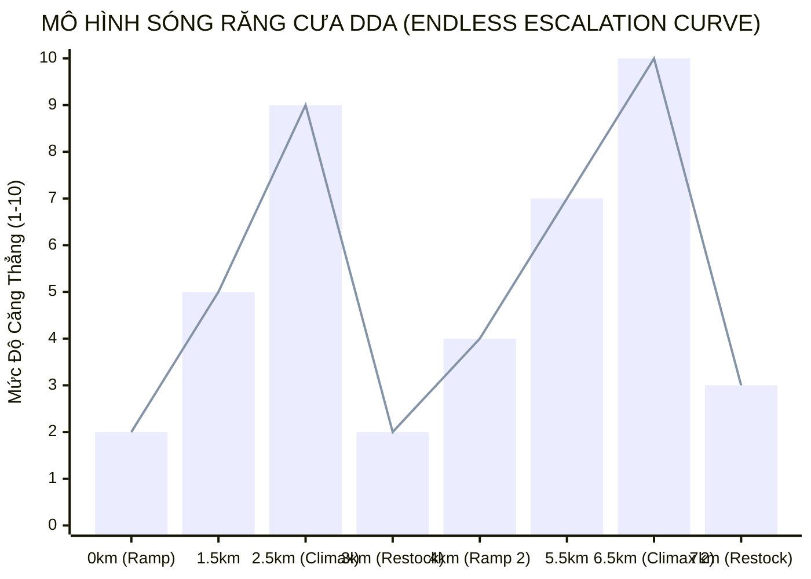
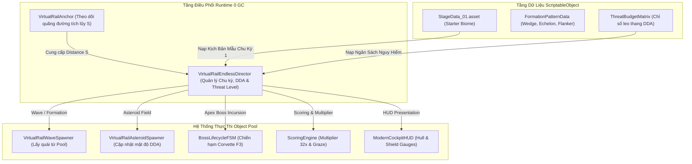
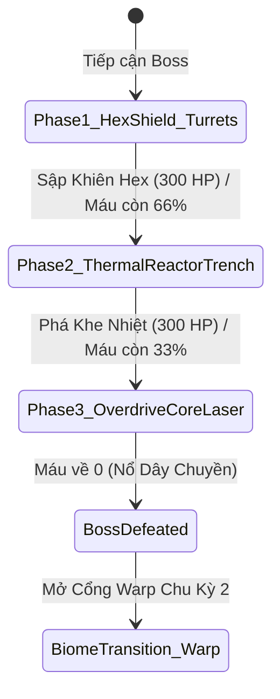

# TÀI LIỆU THIẾT KẾ MÀN CHƠI TOÀN DIỆN & HÀNH LANG VÔ HẠN (LEVEL DESIGN SPECIFICATION - LDS v2.0.0)
> **Dự án:** 3D Space Shooter (Virtual Rail Arcade Shooter)  
> **Chuẩn tham chiếu:** Star Fox 64 (N64 US Rev 1.1), Panzer Dragoon Orta, Sin & Punishment  
> **Định dạng vận hành:** Sinh Tồn Vô Hạn (Endless Procedural Rail & Cyclical Biome Incursions)  
> **Trọng tâm:** Kết hợp biên đạo đội hình mẫu tinh xảo với giải thuật sinh hành lang vô hạn, đường cong nhịp độ răng cưa DDA và đại chiến Trùm đột kích tuần hoàn.  
> **Hiệu lực:** Nguồn Chân Lý Thiết Kế Màn Chơi (Level Design Source of Truth).

---

## MỤC LỤC
1. [Triết Lý Thiết Kế & Trụ Cột Trải Nghiệm (Design Pillars)](#1-triết-lý-thiết-kế--trụ-cột-trải-nghiệm)
2. [Đặc Tính Động Lực Học Đường Ray & Chu Kỳ Không Gian](#2-đặc-tính-động-lực-học-đường-ray--chu-kỳ-không-gian)
3. [Đường Cong Nhịp Độ & Sóng Răng Cưa DDA (Pacing & Tension Curve)](#3-đường-cong-nhịp-độ--sóng-răng-cưa-dda)
4. [Kiến Trúc Hệ Thống Màn Chơi Hướng Dữ Liệu (Data-Driven Architecture)](#4-kiến-trúc-hệ-thống-màn-chơi-hướng-dữ-liệu-data-driven-architecture)
5. [Thiết Kế Chi Tiết Chu Kỳ Khởi Đầu: Vành Đai Thiên Thạch Meteo (Cycle 1 Incursion)](#5-thiết-kế-chi-tiết-chu-kỳ-khởi-đầu-vành-đai-thiên-thạch-meteo)
   - [Giai đoạn 1: Khởi Động & Nhận Diện ($Z: 0\text{m} - 2,500\text{m}$)](#giai-đoạn-1-khởi-động--nhận-diện-z-0m---2500m)
   - [Giai đoạn 2: Chiến Thuật Phi Đội & Đột Kích Sau Lưng ($Z: 2,500\text{m} - 6,500\text{m}$)](#giai-đoạn-2-chiến-thuật-phi-đội--đột-kích-sau-lưng-z-2500m---6500m)
   - [Giai đoạn 3: Hẻm Tử Thần & Vòng Năng Lượng ($Z: 6,500\text{m} - 11,500\text{m}$)](#giai-đoạn-3-hẻm-tử-thần--vòng-năng-lượng-z-6500m---11500m)
   - [Giai đoạn 4: Trung Hạm Tuần Dương Mini-Boss ($Z: 11,500\text{m} - 14,500\text{m}$)](#giai-đoạn-4-trung-hạm-tuần-dương-mini-boss-z-11500m---14500m)
   - [Giai đoạn 5: Đại Chiến Trùm Tuần Duyên Corvette F3 ($Z: 14,500\text{m} - 18,500\text{m}$)](#giai-đoạn-5-đại-chiến-trùm-tuần-duyên-corvette-f3)
   - [Giai đoạn 6: Chuyển Tiếp Quần Xã & Mở Khóa Chu Kỳ Mới ($Z > 18,500\text{m}$)](#giai-đoạn-6-chuyển-tiếp-quần-xã--mở-khóa-chu-kỳ-mới)
6. [Hệ Thống Phân Loại Địch & Ma Trận Cân Bằng (Archetypes & Balance Sheet)](#6-hệ-thống-phân-loại-địch--ma-trận-cân-bằng)
7. [Cơ Chế Thưởng Rủi Ro & Săn Điểm Kỷ Lục (High-Score & Risk Engine)](#7-cơ-chế-thưởng-rủi-ro--săn-điểm-kỷ-lục)

---

## 1. TRIẾT LÝ THIẾT KẾ & TRỤ CỘT TRẢI NGHIỆM

```text
┌─────────────────────────────────────────────────────────────────────────┐
│                           3 TRỤ CỘT THIẾT KẾ                            │
├───────────────────────┬─────────────────────────┬───────────────────────┤
│ 1. ĐIỀU KHIỂN CHÍNH XÁC│ 2. NHỊP ĐỘ ĐIỆN ẢNH     │ 3. THƯỞNG - PHẠT RÕ RÀNG│
│ Máy bay phản hồi tức  │ Sóng răng cưa 3 pha DDA:│ Cơ chế Rủi ro / Phần  │
│ thì, không quán tính  │ Leo dốc -> Đột kích trùm│ thưởng, Graze cận kề, │
│ trôi dạt, triệt tiêu  │ -> Thư giãn hồi sức     │ Multiplier 32x săn kỷ │
│ hoàn toàn sai số 3D.  │ xuyên suốt vô hạn.      │ lục Leaderboard.      │
└───────────────────────┴─────────────────────────┴───────────────────────┘
```

### 1.1. Sự Kết Hợp Giữa Biên Đạo Tinh Xảo và Sinh Hành Lang Vô Hạn
Tựa game dung hòa hai thái cực thiết kế để tạo nên trải nghiệm gây nghiện sâu sắc:
1. **Biên Đạo Đội Hình Mẫu (Handcrafted Choreography Patterns):**
   * Từng đợt quái xuất hiện theo các quỹ đạo Bézier 3D được tính toán kỹ lưỡng (Wedge, Echelon, Diamond, Spiral, Rear Ambush).
   * Mỗi phi đội đều có Tàu Chỉ huy (Leader) và quy tắc phá vỡ đội hình (Panic Scatter) giúp người chơi thỏa mãn cảm giác bắn tụ lực Charge Shot nổ lan dọn sạch cả bầy (+Squad Clear Bonus).
2. **Sinh Hành Lang Vô Hạn & Điều Chỉnh Độ Khó Động (Endless Procedural Rail & DDA):**
   * Đường ray sinh thủ tục liên tục theo từng Chunk $400 - 600\text{m}$ với điều kiện trơn hình học $C^2$ và thuật toán quét trước bảo chứng khả thi (Golden Path Raycast).
   * Độ khó không tăng hỗn loạn mà vận hành theo **Mô hình Sóng Răng Cưa Tăng Tiến (Cyclical Escalation Architecture)**: Leo dốc ($60\%$) $\rightarrow$ Đột kích Trùm / Phi đội Át chủ bài ($25\%$) $\rightarrow$ Thư giãn hồi phục ($15\%$).

---

## 2. ĐẶC TÍNH ĐỘNG LỰC HỌC ĐƯỜNG RAY & CHU KỲ KHÔNG GIAN

Mọi khoảng cách được tính toán dựa trên hệ quy chiếu vật lý thực tế của tàu Arwing trong dự án:

| Thông số | Giá trị chuẩn | Thời gian bay tương ứng / Ghi chú |
| :--- | :--- | :--- |
| **Vận tốc bay cơ sở ($V_{rail}$)** | $120\text{ m/s}$ ($432\text{ km/h}$) | $1,000\text{m} = 8.33\text{ giây}$ |
| **Vận tốc Tăng tốc ($V_{boost}$)** | $180\text{ m/s}$ ($+50\%$) | Tiêu hao năng lượng Boost trong tối đa $3.0\text{s}$ |
| **Vận tốc Phanh hãm ($V_{brake}$)** | $60\text{ m/s}$ ($-50\%$) | Tạo cửa sổ $1.5\times$ thời gian để bắn tỉa |
| **Hành lang bay khả dụng ($X \times Y$)** | Rộng $\pm 22\text{m}$, Cao $1.5\text{m} \sim 15.5\text{m}$ | Khung Frustum máy ảnh tại tiêu cự chuẩn $FOV = 40^\circ$ |
| **Cự ly xuất hiện cảnh báo ($Z_{lead}$)** | $220\text{m} \sim 260\text{m}$ | Cung cấp cửa sổ phản xạ $1.8\text{s} - 2.2\text{s}$ |
| **Chiều dài một Chu kỳ Sinh tồn** | **$2,500\text{m} - 3,500\text{m}$** | **Thời gian mỗi chu kỳ: $60 - 80\text{ giây}$** |
| **Chu kỳ Tái định vị Thế giới** | **$4,000\text{m}$** | Dịch chuyển toàn bộ thực thể về $(0, 0, 0)$ triệt tiêu floating jitter |

---

## 3. ĐƯỜNG CONG NHỊP ĐỘ & SÓNG RĂNG CƯA DDA

Trong môi trường vô hạn, áp lực tâm lý của người chơi được điều phối theo mô hình **Sóng Răng Cưa 3 Pha Tuần Hoàn (Cyclical Tri-Phase Curve)**:



1. **Pha Leo Dốc (Ramp Phase - $60\%$ thời lượng chu kỳ):**
   * Căng thẳng tăng tuyến tính từ mức $2 \to 6$.
   * Tăng dần mật độ quái vật, tốc độ tiếp cận và tỷ lệ thiên thạch bất hoại Monolith.
2. **Pha Đỉnh Điểm (Climax Encounter - $25\%$ thời lượng chu kỳ):**
   * Căng thẳng chạm đỉnh $9 - 10$.
   * Hành lang bị thu hẹp, xuất hiện bầy tiêm kích bủa vây gọng kìm hoặc kích hoạt **Đột Kích Trùm Tuần Duyên (Corvette F3 Apex Incursion)**.
3. **Pha Thư Giãn & Thu Hoạch (Breather / Restock - $15\%$ thời lượng chu kỳ):**
   * Căng thẳng hạ tức thời về mức $1 - 2$.
   * Không gian mở rộng, xuất hiện các chuỗi Vòng Năng Lượng (Gold Rings / Silver Rings) hồi máu, sạc khiên và nâng cấp hỏa lực trước khi bước vào chu kỳ tiếp theo với Threat Level cao hơn.

---

## 4. KIẾN TRÚC HỆ THỐNG MÀN CHƠI HƯỚNG DỮ LIỆU (DATA-DRIVEN ARCHITECTURE)

Hệ thống kết hợp giữa kịch bản mẫu tĩnh ([`StageData.cs`](file:///d:/3D-Shooter-master/Assets/Scripts/VirtualRail/StageData.cs)) và bộ điều phối vô hạn ([`VirtualRailEndlessDirector.cs`](file:///d:/3D-Shooter-master/Assets/Scripts/VirtualRail/VirtualRailEndlessDirector.cs)):



---

## 5. THIẾT KẾ CHI TIẾT CHU KỲ KHỞI ĐẦU: VÀNH ĐAI THIÊN THẠCH METEO
*(Starter Biome / Cycle 1 Incursion Run)*

### TỔNG QUAN NHIỆM VỤ (MISSION BRIEFING)
- **Địa điểm:** Vành đai tiểu hành tinh Meteo (Outer Rim Asteroid Belt).
- **Mục tiêu:** Vượt qua hành lang thiên thạch khởi đầu, làm quen nhịp độ bay Arwing, tiêu diệt Trung Hạm Tuần Tiêu và đánh bại **Chiến Hạm Tuần Duyên Liên Bang Corvette F3 ("Crimson Titan")**.
- **Mục tiêu săn điểm:** Đạt chuỗi Combo Multiplier tối thiểu $16\times$, thu thập đủ 5 Vòng Vàng để mở khóa Twin Laser vĩnh viễn và hoàn tất trận đấu Trùm với khiên còn nguyên vẹn.

---

### GIAI ĐOẠN 1: KHỞI ĐỘNG & NHẬN DIỆN ($Z: 0\text{m} - 2,500\text{m}$)
*Thời gian dự kiến: $0\text{s} - 21\text{s}$ | Mức căng thẳng: $2/10$*

```text
[Z = 0m]      ──► XUẤT KÍCH: Tàu Arwing tách khỏi tàu mẹ, ổn định vận tốc cơ sở 120 m/s.
[Z = 400m]    ──► THIÊN THẠCH THƯA: Vài tảng đá nhỏ trôi dạt (cự ly 150m), dễ dàng bắn nổ bằng 1 phát đạn.
[Z = 1,000m]  ──► ĐỢT TRINH SÁT 1: 3 Tàu địch trinh sát bay trực diện (Frontal Head-on).
                  Bay thẳng tắp, không xả đạn, người chơi làm quen với Dual Reticle và tiêu cự hội tụ.
[Z = 1,800m]  ──► ĐỢT TRINH SÁT 2: 4 Tàu địch bay lượn sóng hình Sin nhẹ.
                  Thử thách rê chuột/analog đón đầu đường bay (Lead Aiming).
```

---

### GIAI ĐOẠN 2: CHIẾN THUẬT PHI ĐỘI & ĐỘT KÍCH SAU LƯNG ($Z: 2,500\text{m} - 6,500\text{m}$)
*Thời gian dự kiến: $21\text{s} - 54\text{s}$ | Mức căng thẳng: $5/10$*

```text
[Z = 2,800m]  ──► PHI ĐỘI CHỮ V (WEDGE FORMATION):
                  Phi đội 3 tàu ráp nối Bézier từ trần mây lao xuống.
                  - Slot 0 (Chỉ huy đỏ) nằm ở đỉnh chữ V, 2 tàu cánh bảo vệ phía sau.
                  - Thưởng: Diệt Tàu Chỉ huy trước -> 2 tàu cánh Panic Scatter -> Người chơi dùng
                    Charge Shot nổ lan hốt trọn cụm, nhận ngay Combo Multiplier +1 Cấp!
[Z = 4,000m]  ──► CẢNH BÁO REAR AMBUSH (ĐỘT KÍCH SAU LƯNG):
                  Âm thanh radar kêu "BEEP-BEEP!". 2 Tàu tiêm kích địch vọt lên từ sau lưng (Z = -40m),
                  áp sát 2 bên sườn và xả đạn Plasma Orb.
                  - Ống xả đuôi tàu địch phát sáng đỏ (Điểm yếu chí mạng - 1 Hit tiêu diệt).
[Z = 5,200m]  ──► PHI ĐỘI HÀNG NGANG (ECHELON):
                  4 Tàu địch dàn hàng ngang quét từ biên trái sang biên phải màn hình.
                  Buộc người chơi tụ lực Charge Shot phóng vào giữa để tạo chấn động nổ lan.
[Z = 6,200m]  ──► KHOẢNG LẶNG ĐỊNH THẦN (BREATHING ROOM):
                  Không gian vắng bóng tàu địch trong 3 giây.
                  Xuất hiện 1 Vòng Bạc hồi phục khiên (Silver Ring) trôi ngay giữa màn hình.
```

---

### GIAI ĐOẠN 3: HẺM TỬ THẦN & VÒNG NĂNG LƯỢNG ($Z: 6,500\text{m} - 11,500\text{m}$)
*Thời gian dự kiến: $54\text{s} - 96\text{s}$ | Mức căng thẳng: $8/10$*

```text
[Z = 6,600m]  ──► BƯỚC VÀO TRẬN ĐỊA THIÊN THẠCH DÀY ĐẶC (ASTEROID TRENCH RUN):
                  - Mật độ thiên thạch tăng vọt (bước Z giảm từ 50m xuống 25m).
                  - Xuất hiện các khối THIÊN THẠCH KHỔNG LỒ (Monoliths) đường kính 20m không thể phá hủy.
                  - Hẻm bay an toàn uốn lượn ngoằn ngoèo:
                    * Khúc cua 1 (Z = 7,500m): Đánh võng gấp sang mép trái (X = -18m).
                    * Khúc cua 2 (Z = 8,800m): Nâng độ cao đột ngột lên trần mây (Y = 14m).
[Z = 7,800m]  ──► CHUỖI 3 CỔNG VÀNG RỦI RO / PHẦN THƯỞNG (GOLD RING RUN):
                  - 3 Cổng Vàng được đặt liên tiếp ngay sát rìa các tảng đá khổng lồ.
                  - Thách thức: Người chơi buộc phải bay mấp mé va quẹt đá để ăn trọn chuỗi cổng.
                  - Phần thưởng: Hồi 100% khiên lục giác và nâng cấp vĩnh viễn lên TWIN LASER!
[Z = 9,500m]  ──► ĐỐI ĐẦU ĐỊCH TẠT SƯỜN TRONG HẺM ĐÁ (FLANKING HAZARDS):
                  Trong khi đang luồn lách né đá, kẻ địch cắt ngang từ 2 vách hẻm xả bão đạn.
                  - Thời điểm VÀNG kích hoạt BARREL ROLL: Nhấp đúp lộn cánh bẻ gãy bão đạn địch
                    mà không cần nhả lái tránh đá!
```

---

### GIAI ĐOẠN 4: TRUNG HẠM TUẦN DƯƠNG MINI-BOSS ($Z: 11,500\text{m} - 14,500\text{m}$)
*Thời gian dự kiến: $96\text{s} - 121\text{s}$ | Mức căng thẳng: $9/10$*

```text
[Z = 11,500m] ──► CẢNH BÁO: "HEAVY SIGNATURE APPROACHING"
                  Một Tàu Tuần Dương Hạm cự phách ("Iron Vanguard") từ trên cao hạ độ cao xuống,
                  đồng tốc với tàu người chơi ở cự ly Z = +70m trước mũi.
[Z = 11,800m] ──► GIAO TRANH 3 CỤM MỤC TIÊU:
                  - Tháp pháo cánh trái (HP: 60): Bắn đạn chùm 3 viên.
                  - Tháp pháo cánh phải (HP: 60): Bắn đạn chùm 3 viên.
                  - Ống phóng tên lửa trung tâm (HP: 120): Liên tục phóng Tên lửa dẫn đường.
[Z = 12,200m] ──► THẾ TRẬN ĐỐI KHÁNG:
                  - Bắn nổ tên lửa tầm nhiệt trên không (Destructible Projectiles).
                  - Bắn nổ 2 tháp pháo cánh bộc lộ Buồng Lái (Bridge Weakpoint).
[Z = 13,800m] ──► TIÊU DIỆT MINI-BOSS:
                  - Bắn nổ buồng lái: Chiến hạm nổ tung, rơi 1 BOM THÔNG MINH và thưởng +10 Hits!
```

---

### GIAI ĐOẠN 5: ĐẠI CHIẾN TRÙM TUẦN DUYÊN CORVETTE F3
*($Z: 14,500\text{m} - 18,500\text{m}$ | ĐỈNH CAO TRÀO CHU KỲ 1)*

```text
[Z = 14,500m] ──► KÍCH HOẠT ĐẤU TRƯỜNG TRÙM (APEX BOSS INCURSION):
                  - Báo động đỏ toàn màn hình: "WARNING! CORVETTE F3 'CRIMSON TITAN' DETECTED".
                  - Tốc độ ray hãm về vận tốc tuần tra chậm V = 10 m/s để người chơi tập trung quần thảo.
                  - Thanh Máu Boss hiện ở đáy màn hình với 3 phân đoạn máu riêng biệt.
```



#### Quy Luật 3 Pha Của Boss Tuần Duyên Corvette F3:
1. **Pha 1: Khiên Năng Lượng Lục Giác & Hỏa Lực Sườn ($100\% \rightarrow 66\%\text{ HP}$):**
   * Boss triển khai lớp khiên lục giác bao bọc thân trên ([`VirtualRailHexShield.cs`](file:///d:/3D-Shooter-master/Assets/Scripts/VirtualRail/VirtualRailHexShield.cs) - $300\text{ HP}$), phát sáng chớp trắng Neon White khi trúng đạn.
   * 2 Tháp pháo cánh xả đạn plasma và phóng tên lửa tự dẫn.
   * Người chơi tập trung hỏa lực bắn sập khiên để bộc lộ cấu trúc bên dưới.
2. **Pha 2: Hẻm Lò Phản Ứng Lộ Diện ($66\% \rightarrow 33\%\text{ HP}$):**
   * Lớp khiên sụp đổ, khe tản nhiệt nhiệt hạch bộc lộ hiệu ứng dung nham plasma rực sáng ([`VirtualRail_ThermalReactorTrench.shader`](file:///d:/3D-Shaders/VirtualRail_ThermalReactorTrench.shader)).
   * Boss bắt đầu tích tụ năng lượng theo từng xung nhịp thở. Bắn trúng hẻm lò phản ứng sẽ làm gián đoạn xung nạp (Stun Interrupt Glitch).
   * Ống xả phụ và buồng lái `_mainBridge` trở thành mục tiêu săn điểm thưởng.
3. **Pha 3: Quá Tải Lõi & Cuồng Nộ Tia Hủy Diệt ($33\% \rightarrow 0\%\text{ HP}$ - Enrage Mode):**
   * Khe tản nhiệt vỡ vụn, lõi chuyển sang trạng thái quá nhiệt đỏ rực.
   * **Tia Hủy Diệt Hyper Laser:** Boss nạp năng lượng trong $2.0\text{s}$ và quét luồng laser khổng lồ chiếm $60\%$ diện tích màn hình. Buộc người chơi phải ép sát góc mép biên để sinh tồn.
   * Cửa sổ vàng phản công: Lõi mất hoàn toàn phòng thủ khi đang quét laser, người chơi xả toàn bộ Smart Bomb và Twin Laser để kết liễu trùm!

---

### GIAI ĐOẠN 6: CHUYỂN TIẾP QUẦN XÃ & MỞ KHÓA CHU KỲ MỚI ($Z > 18,500\text{m}$)
*Thời gian dự kiến: $165\text{s} - 180\text{s}$ | GIẢI TỎA ÁP LỰC & NẠP QUẦN XÃ TIẾP THEO*

```text
[Z = 18,500m] ──► HẠ GỤC TRÙM & THƯỞNG ĐIỂM SỐ CỰC ĐẠI:
                  - Corvette F3 phát nổ dây chuyền, vỡ tung thành các khối mảnh kim loại cháy rực.
                  - Thưởng tức thì: +50,000 PTS x Hệ số Multiplier hiện tại!
                  - Toàn bộ đạn địch trên màn hình tự động chuyển hóa thành Vòng Điểm Sao (Star Pickups).
[Z = 18,800m] ──► PHA THƯ GIÃN (BREATHER & RESTOCK):
                  - Cổng Warp không gian mở ra phía trước.
                  - Xuất hiện chuỗi 5 Vòng Năng Lượng hồi phục đầy đủ Thân Tàu và Khiên.
[Z = 19,000m] ──► NHẢY VỌT HYPERSPACE VÀO CHU KỲ 2:
                  - Kích hoạt hiệu ứng Warp Speed trong 2.5s.
                  - Nạp Quần xã mới (Vùng Biển Dung Nham / Tinh Vân Sâu) với Threat Level k = 2.
                  - Vòng lặp sinh tồn tiếp diễn với độ khó leo thang theo đúng LDS & Endless Spec!
```

---

## 6. HỆ THỐNG PHÂN LOẠI ĐỊCH & MA TRẬN CÂN BẰNG

| Tên Mã Kẻ Địch | Vai trò chiến thuật | Máu ($HP$) | Vũ khí & Đạn đạo | Điểm yếu / Cơ chế khắc chế | Điểm ($PTS$) |
| :--- | :--- | :--- | :--- | :--- | :--- |
| **Drone Trinh Sát (Scout-01)** | Quân cờ chào sân, dạy ngắm bắn | $20$ (1 hit thường) | Bắn 1 viên chậm $20\text{ m/s}$ | Bay theo đường thẳng, tiết diện lớn | $100\text{ pts}$ |
| **Tiêm Kích Sườn (Flanker-02)** | Gây nhiễu khi đang luồn lách né đá | $40$ (2 hit thường) | Bắn chùm 2 viên Plasma Orb góc $45^\circ$ | Lộn cánh Barrel Roll hất ngược đạn | $250\text{ pts}$ |
| **Đột Kích Đuôi (Interceptor-03)** | Trừng phạt người chơi không quan sát sau | $35$ | Bắn đạn Dart tốc độ cao đuổi đuôi tàu | Ống xả phát quang sau đuôi ($200\%$ damage) | $400\text{ pts}$ |
| **Chỉ Huy Đội Hình (Leader-Wedge)** | Giữ vững đội hình bay 3D | $80$ (Cần tụ lực) | Bắn cầu lửa Plasma nổ bán kính $3\text{m}$ | Tiêu diệt trước làm vỡ trận cả phi đội | $800\text{ pts}$ |
| **Trung Hạm (Cruiser Mini-Boss)** | Thử thách hỏa lực giữa màn | $300$ (Tổng cụm) | Tên lửa tầm nhiệt + 2 Pháo chùm laser | Bắn nổ 2 tháp pháo để lộ buồng lái | $2,500\text{ pts}$ |
| **Corvette F3 "Crimson Titan"** | Trùm đột kích đỉnh cao trào chu kỳ | $1,000$ (3 pha) | Khiên Hex, Plasma, Tên lửa, Hyper Laser | Bắn sập khiên, tập trung khe nhiệt lúc quá tải | $50,000\text{ pts}$ |

---

## 7. CƠ CHẾ THƯỞNG RỦI RO & SĂN ĐIỂM KỶ LỤC

Tuân thủ nghiêm ngặt động cơ tính điểm sâu trong [`ENDLESS_SCORING_SPECIFICATION.md`](file:///d:/3D-Shooter-master/ENDLESS_SCORING_SPECIFICATION.md):

### 7.1. Bảng Nhân Combo Multiplier ($1\times \to 32\times$)
* Điểm số nhân theo cấp số nhân: $1\times \to 2\times \to 4\times \to 8\times \to 16\times \to \mathbf{32\times}$.
* Duy trì bằng thanh năng lượng suy giảm trong $3.5\text{s}$.
* **Cách sạc đầy thanh năng lượng:**
  * Bắn hạ trọn vẹn một phi đội (+Squad Wipeout).
  * Tiêu diệt cụm bằng bắn tụ lực nổ lan (+Charge Shot Multikill).
  * Kích hoạt cơ chế Lướt Cận Kề (**Graze**).

### 7.2. Cơ Chế Lướt Cận Kề (Graze / Near-Miss)
* **Hitbox kép:** Lõi va chạm $R = 0.5\text{m}$, Vỏ lướt sát $R = 1.8\text{m}$.
* Đạn địch bay xuyên qua vỏ lướt sát mà không trúng lõi tàu:
  * Không mất máu, phát ra tiếng rít quang học dọc sườn cánh.
  * Thưởng tức thì: $+500\text{ Điểm} \times \mathbf{M}$.
  * Hồi phục ngay lập tức $30\%$ dung lượng thanh thời gian Multiplier Decay.

---

> [!NOTE]
> Tài liệu này là nguồn chân lý thiết kế cho toàn bộ các màn chơi và chu kỳ vô hạn của dự án. Mọi nâng cấp tiếp theo về quái vật, chướng ngại vật và Boss đều phải bám sát cấu trúc sóng răng cưa 3 pha DDA và ma trận cân bằng được quy định tại đây.
