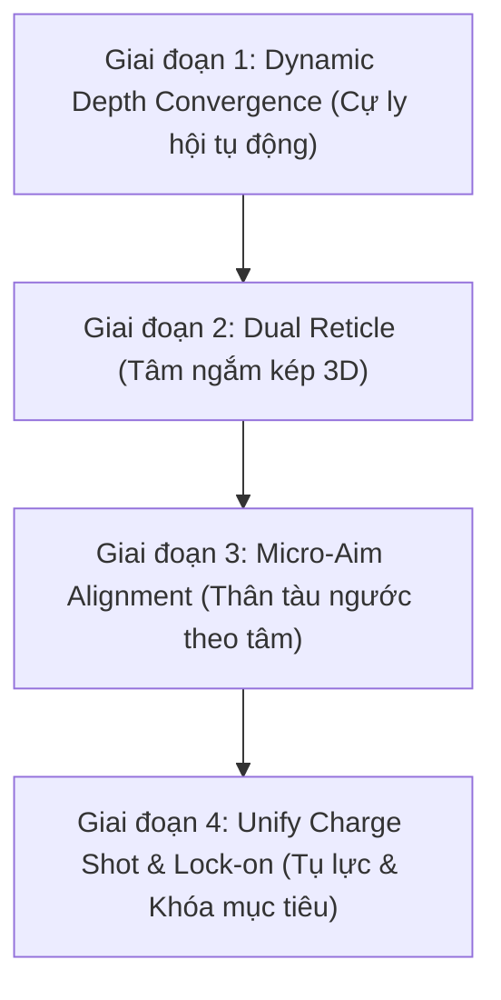

# Kế hoạch Hoàn thiện Cơ chế Ngắm bắn & Đường đạn Chuẩn Star Fox 64 Arcade

Tài liệu này trình bày giải pháp kỹ thuật và lộ trình nâng cấp toàn diện hệ thống ngắm bắn (Aiming) và đạn đạo (Ballistics) từ trạng thái cơ bản hiện tại lên chuẩn mực Arcade hoàn chỉnh (tương đương trải nghiệm kinh điển của *Star Fox 64* và *Panzer Dragoon*).

---

## 1. Mục tiêu & Bối cảnh

### Vấn đề hiện tại:
1. **Cự ly hội tụ cố định (150m):** Khi kẻ địch ở cự ly gần ($20 - 50\text{m}$), đạn xuất phát từ 2 cánh tàu chưa kịp chụm lại theo hình chữ V, dẫn đến việc đạn bay kẹp sang 2 bên hông mục tiêu dù tâm ngắm đặt trúng.
2. **Thiếu chiều sâu thị giác (Single Reticle):** Chỉ có một ô vuông 2D đơn lẻ, người chơi không cảm nhận được thị sai chiều sâu 3D giữa mũi tàu và mục tiêu ở xa.
3. **Thân tàu và tâm ngắm bị tách rời góc quay:** Khi tâm ngắm ở góc xa, thân tàu không có phản xạ ngước/liếc mũi theo góc ngắm, khiến tia đạn bắn ra từ cánh tàu bị bẻ góc gắt mất tự nhiên.
4. **Hệ thống tụ lực (Charge Shot) và khóa mục tiêu (Lock-on) bị cô lập:** Chưa hòa nhập vào luồng bắn vũ khí chính (`VirtualRailWeapon`).

### Mục tiêu sau khi hoàn thiện:
* Bắn trúng 100% mục tiêu tại mọi khoảng cách ($20\text{m} - 250\text{m}$) nhờ **Hội tụ độ sâu động (Dynamic Depth Convergence)**.
* Hiển thị **Tâm ngắm kép (Dual Reticle)** chuẩn Star Fox 64 giúp người chơi canh độ sâu trực quan.
* Mũi tàu ngước nhẹ khí động học theo góc ngắm (**Micro-Aim Alignment**).
* Hợp nhất cơ chế nhấp bắn (Tap Fire) và tụ lực khóa mục tiêu (Hold-to-Charge Lock-on) trên cùng 1 nút bắn.
* Tuân thủ nghiêm ngặt **Kiến trúc an toàn 3 tầng (3-Layer Safety & Undo Protocol)** và **0 GC Alloc**.

---

## 2. Quyết định thiết kế đã được người dùng phê duyệt (Confirmed Decisions)

> [!TIP]
> **Kiểu hiển thị của Tâm ngắm kép (Dual Reticle): ĐÃ CHỌN PHƯƠNG ÁN A (Chuẩn Star Fox 64)**
> * **Tâm ngắm gần (Near Crosshair):** Vòng tròn nhỏ / dấu thập thanh mảnh màu xanh lá gắn tại $Z = 35\text{m}$ trước mũi tàu.
> * **Tâm ngắm xa (Far Reticle):** Ô vuông Cyan lớn tại $Z = 150\text{m}$ điều khiển bởi chuột/cần gạt.
> * Khi tàu bay thẳng, vòng tròn gần lồng vào giữa ô vuông xa. Khi lượn cánh, 2 tâm ngắm tách nhẹ tạo cảm giác thị sai chiều sâu không gian 3D.

---

## 3. Lộ trình triển khai 4 giai đoạn (Phased Implementation)

---

### Giai đoạn 1: Dynamic Depth Convergence (Hội tụ độ sâu động)
*Ưu tiên cao nhất — Giải quyết triệt để lỗi bắn gần hụt đạn.*

* **Nguyên lý:**
  1. Khi bóp cò (hoặc mỗi frame khi rê ngắm), phóng 1 tia `Ray` từ Camera xuyên qua tọa độ tâm ngắm trên màn hình ra thế giới:
     $$\text{Ray} = \text{Camera.ScreenPointToRay}(\text{ReticleScreenPos})$$
  2. Thực hiện `Physics.RaycastNonAlloc` (0 GC Alloc) theo hướng tia này với tầm xa tối đa `cfg.convergenceDistance * 1.5f` trên tầng `cfg.enemyLayer`:
     - **Nếu trúng mục tiêu (Kẻ địch / Thiên thạch) ở cự ly $D_{\text{hit}}$:**
       $$\text{Điểm hội tụ } P_{\text{target}} = \text{Ray.GetPoint}(D_{\text{hit}})$$
       *(Cả 2 nòng súng sẽ lập tức chụm đạn chính xác vào cự ly $D_{\text{hit}}$ của mục tiêu).*
     - **Nếu bắn vào khoảng không trống trải:**
       $$\text{Điểm hội tụ } P_{\text{target}} = \text{Ray.GetPoint}(\text{cfg.convergenceDistance})$$
* **Tệp tác động:**
  - [`VirtualRailWeapon.cs`](file:///d:/3D-Shooter-master/Assets/Scripts/VirtualRail/VirtualRailWeapon.cs)
  - [`VirtualRailConfig.cs`](file:///d:/3D-Shooter-master/Assets/Scripts/VirtualRail/VirtualRailConfig.cs) (Thêm cờ `enableDynamicDepthConvergence`, mặc định `true`).

---

### Giai đoạn 2: Dual Reticle System (Hệ tâm ngắm kép Near & Far)
*Tạo cảm nhận chiều sâu không gian 3D chuẩn Star Fox 64.*

* **Nguyên lý:**
  1. Tạo thêm 1 điểm neo tâm ngắm gần: `[Near Reticle Anchor]` đặt tại $Z = 35\text{m}$ phía trước mũi tàu.
  2. Vị trí tâm ngắm gần di chuyển theo trục ngắm của thân tàu, tạo góc nhìn thị sai so với tâm ngắm xa ở $150\text{m}$.
  3. Trên Canvas UI:
     - **Outer Reticle (Tâm xa):** Ô vuông màu xanh lơ (Cyan) đại diện cho điểm đến của vũ khí tầm xa.
     - **Inner Reticle (Tâm gần):** Vòng tròn / dấu thập thanh mảnh màu xanh lá (Green) đại diện cho hướng mũi tàu.
     - Khi người chơi căn chuẩn mục tiêu, 2 tâm ngắm sẽ lồng vào nhau, tạo phản hồi thị giác cực kỳ đã mắt.
* **Tệp tác động:**
  - [`VirtualRailReticle.cs`](file:///d:/3D-Shooter-master/Assets/Scripts/VirtualRail/VirtualRailReticle.cs)
  - [`VirtualRailModeToggle.cs`](file:///d:/3D-Shooter-master/Assets/Editor/VirtualRailModeToggle.cs) (Cập nhật tạo UI tâm ngắm kép).

---

### Giai đoạn 3: Micro-Aim Alignment (Khí động học ngước mũi theo tâm)
*Triệt tiêu hiện tượng đạn bị bắn "chéo cánh" thiếu tự nhiên.*

* **Nguyên lý:**
  1. Tính vector góc lệch giữa hướng nhìn hiện tại của tàu (`ship.transform.forward`) và vector trỏ tới tâm ngắm (`aimWorld - ship.position`).
  2. Bổ sung một góc quay vi sai nhỏ ($\pm 4^\circ - 7^\circ$ Pitch và Yaw) vào `targetRotation` của tàu:
     $$\text{Pitch}_{\text{aim}} = \text{Mathf.Clamp}(\Delta Y \times k_{\text{aim}}, -6^\circ, 6^\circ)$$
     $$\text{Yaw}_{\text{aim}} = \text{Mathf.Clamp}(\Delta X \times k_{\text{aim}}, -8^\circ, 8^\circ)$$
  3. Khi rê chuột lên góc phải, mũi tàu sẽ hơi ngước nhẹ và liếc sang phải theo góc ngắm, giúp nòng súng luôn thẳng trục với hướng đạn phóng ra.
* **Tệp tác động:**
  - [`VirtualRailShip.cs`](file:///d:/3D-Shooter-master/Assets/Scripts/VirtualRail/VirtualRailShip.cs)
  - [`VirtualRailConfig.cs`](file:///d:/3D-Shooter-master/Assets/Scripts/VirtualRail/VirtualRailConfig.cs) (Thêm cờ `enableMicroAimAlignment`, hệ số `microAimWeight = 0.35f`).

---

### Giai đoạn 4: Hợp nhất Tụ lực (Charge Shot) & Khóa mục tiêu (Lock-on)
*Hoàn chỉnh cơ chế chiến đấu Star Fox 64.*

* **Nguyên lý:**
  1. Hợp nhất `AimAssistModule` vào luồng xử lý của `VirtualRailWeapon`:
     - **Nhấp phím (Tap < 0.25s):** Bắn đạn laser đôi bình thường.
     - **Giữ phím (Hold > 0.3s):** Tàu bắt đầu phát sáng nạp năng lượng (Charge VFX & SFX).
     - **Trong khi giữ phím:** Quét tìm mục tiêu gần tâm ngắm nhất trong hình nón $18^\circ$; nếu tìm thấy, khóa mục tiêu (Khung khóa Target Lock snap vào mục tiêu).
     - **Nhả phím (Release):** Phóng quả cầu plasma năng lượng cao (Homing Charge Shot) tự dẫn đường bay xoáy về phía mục tiêu và phát nổ lan diện rộng ($R = 10\text{m}$).
* **Tệp tác động:**
  - [`VirtualRailWeapon.cs`](file:///d:/3D-Shooter-master/Assets/Scripts/VirtualRail/VirtualRailWeapon.cs)
  - [`AimAssistModule.cs`](file:///d:/3D-Shooter-master/Assets/Scripts/VirtualRail/AimAssistModule.cs)

---

## 4. Danh mục tệp dự kiến thay đổi (Proposed Changes)

### Cấu hình & Dữ liệu
#### [MODIFY] [`VirtualRailConfig.cs`](file:///d:/3D-Shooter-master/Assets/Scripts/VirtualRail/VirtualRailConfig.cs)
* Bổ sung các biến cấu hình cho Hội tụ động, Tâm ngắm kép và Micro-Aim.
#### [MODIFY] [`DefaultVirtualRailConfig.asset`](file:///d:/3D-Shooter-master/Assets/Scripts/VirtualRail/DefaultVirtualRailConfig.asset)
* Thiết lập các giá trị mặc định tối ưu sẵn cho game.

### Vũ khí & Đạn đạo
#### [MODIFY] [`VirtualRailWeapon.cs`](file:///d:/3D-Shooter-master/Assets/Scripts/VirtualRail/VirtualRailWeapon.cs)
* Bổ sung logic Dynamic Depth Convergence bằng Raycast không rác bộ nhớ (`RaycastNonAlloc`).
* Tích hợp xử lý nhấp bắn/giữ phím tụ lực.

### Tâm ngắm & Điều khiển tàu
#### [MODIFY] [`VirtualRailReticle.cs`](file:///d:/3D-Shooter-master/Assets/Scripts/VirtualRail/VirtualRailReticle.cs)
* Thêm logic tính toán tọa độ và cập nhật UI cho Near Reticle (Tâm ngắm gần).
#### [MODIFY] [`VirtualRailShip.cs`](file:///d:/3D-Shooter-master/Assets/Scripts/VirtualRail/VirtualRailShip.cs)
* Thêm vi sai góc quay Micro-Aim Alignment.

### Công cụ Editor & Hoàn nguyên (3-Layer Undo)
#### [MODIFY] [`VirtualRailModeToggle.cs`](file:///d:/3D-Shooter-master/Assets/Editor/VirtualRailModeToggle.cs)
* Bổ sung các Menu Item chuyển đổi 1-click:
  - `Tools > Virtual Rail > 33. Aiming: Dynamic Depth Convergence (ON/OFF)`
  - `Tools > Virtual Rail > 34. Aiming: Dual Reticle Star Fox Mode (ON/OFF)`
  - `Tools > Virtual Rail > 35. Aiming: Micro-Aim Alignment (ON/OFF)`

---

## 5. Kế hoạch kiểm chứng (Verification Plan)

### Kiểm tra tự động & Không rác bộ nhớ (Memory Check):
* Chạy biên dịch kiểm tra **0 lỗi**, **0 cảnh báo**.
* Dùng Unity Profiler xác nhận: `RaycastNonAlloc` đạt **0 GC Alloc** trong suốt quá trình bắn liên thanh.

### Kiểm chứng trải nghiệm (Gameplay Testing):
1. **Kiểm tra cự ly gần ($20 - 40\text{m}$):**
   * Đặt tâm ngắm lên thiên thạch/quái đang bay sát tàu $\rightarrow$ Đạn chụm chính xác ngay tại bề mặt mục tiêu, trúng đích 100%.
2. **Kiểm tra cự ly xa ($150 - 200\text{m}$):**
   * Đạn bay thẳng tắp đến vô cực hoặc mục tiêu xa theo đúng ô vuông Reticle.
3. **Kiểm tra thị sai tâm ngắm kép:**
   * Khi lượn tàu, vòng tròn gần và ô vuông xa tách nhẹ tạo cảm giác 3D, khi bay thẳng thì chập làm một.
4. **Kiểm tra hoàn nguyên (Undo):**
   * Tắt cờ hoặc dùng menu chuyển đổi để hoàn nguyên về cơ chế cũ bất kỳ lúc nào nếu muốn so sánh.
